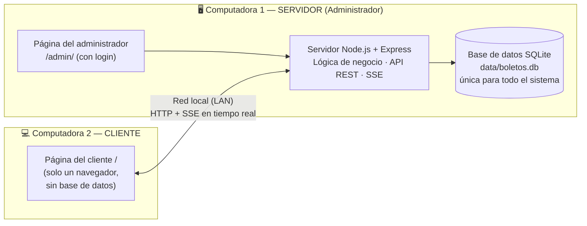

# 🚌 Las Cobras Viajes — Sistema de venta de boletos

Sistema de venta de pasajes de bus para una agencia de viajes, con **una computadora como servidor** (administrador + base de datos) y **computadoras cliente** que se conectan por la red local. Incluye:

- **Concurrencia estricta**: es imposible vender dos veces el mismo asiento, aunque cientos de clientes lo intenten en el mismo milisegundo.
- **Tiempo real**: el mapa interactivo del bus (2 pisos) se actualiza al instante en todos los navegadores mediante **Server-Sent Events (SSE)**.
- **Embarque con QR**: cada boleto lleva un QR **firmado con HMAC-SHA256**; el módulo de embarque lo lee con la cámara o con un lector USB y rechaza QR falsos, boletos anulados, de otra salida o ya usados.
- **Impresión térmica de 58 mm**: vista HTML optimizada para rollo de 58 mm y generación de comandos **ESC/POS** nativos (QR impreso por la propia impresora, corte de papel) con envío directo a impresoras de red por el puerto 9100.

  

---

## Arquitectura: una computadora como servidor



| | Computadora 1 — Servidor | Computadora 2 — Cliente |
|---|---|---|
| **Quién la usa** | Personal de la agencia (administrador) | Pasajeros / punto de venta |
| **Qué abre** | `http://localhost:3000/admin/` | `http://IP-DEL-SERVIDOR:3000/` |
| **Interfaz** | Panel, salidas, ventas, reportes y embarque | Buscar salidas, elegir asiento en el mapa, comprar, imprimir boleto |
| **Lógica de negocio** | ✅ Toda (Node.js) | — (la pide al servidor por la red) |
| **Base de datos** | ✅ SQLite, un solo archivo | ❌ No tiene: se conecta al servidor |
| **Instalación** | Node.js + `npm install` | Ninguna: solo un navegador |

Todas las computadoras cliente comparten **la misma base de datos** a través del servidor, así que lo que vende una computadora se ve al instante en las demás y en el panel del administrador. Las reglas que evitan la doble venta están en el servidor y en la base de datos, por eso funcionan aunque haya muchos clientes a la vez.

**¿Por qué los clientes no se conectan directamente a la base de datos (como con JDBC)?** Por seguridad y consistencia: si cada cliente tuviera usuario y contraseña de la BD, cualquiera podría modificar ventas a mano. Aquí el cliente solo puede hacer lo que la API permite (reservar, comprar), y el servidor valida cada operación dentro de una transacción.

---

## Instalación paso a paso

### 1. En la Computadora 1 (servidor / administrador)

Requisitos: **Node.js 22.13 o superior** ([descargar](https://nodejs.org)). No hace falta instalar ninguna base de datos: se usa el SQLite integrado en Node (`node:sqlite`).

```bash
git clone https://github.com/leonelchamorrocajahuaman1-glitch/venta-boletos-agencia.git
cd venta-boletos-agencia
npm install
npm start
```

La consola muestra las direcciones:

```
🐍 Las Cobras Viajes — servidor iniciado (Computadora 1)

   ADMINISTRADOR (en esta computadora):
     http://localhost:3000/admin/

   CLIENTES (desde otras computadoras de la red local):
     http://192.168.1.15:3000/
```

Abre `http://localhost:3000/admin/` e inicia sesión con **usuario `admin` / contraseña `admin123`** (cámbiala con la variable `ADMIN_PASSWORD` antes del primer arranque). El panel también muestra la dirección que deben usar los clientes.

> **Windows:** la primera vez, el Firewall pregunta si Node.js puede comunicarse en redes privadas → **Permitir**. Si no apareció, ejecuta en PowerShell como administrador:
> `New-NetFirewallRule -DisplayName "Las Cobras Viajes" -Direction Inbound -Protocol TCP -LocalPort 3000 -Action Allow -Profile Private`
>
> Para saber la IP del servidor manualmente: `ipconfig` (Windows) o `ip addr` / `ifconfig` (Linux/Mac).

### 2. En la Computadora 2 (cliente)

Conéctala a la **misma red** (mismo Wi-Fi o switch) y abre en cualquier navegador la dirección que mostró el servidor, por ejemplo `http://192.168.1.15:3000/`. No se instala nada.

### Probar con una sola computadora

Abre `http://localhost:3000/admin/` en una ventana y `http://localhost:3000/` en otra (o en una ventana de incógnito). Compra un pasaje en la del cliente: en el panel del administrador aparece al instante en **Actividad en vivo** y se actualizan los indicadores.

### ¿No carga en el celular? (solución de problemas)

Haz las comprobaciones en este orden:

1. **No uses `localhost` en el celular.** `localhost` siempre significa "este mismo aparato", así que en el celular busca un servidor dentro del propio celular. Usa la IP del servidor, por ejemplo `http://192.168.1.15:3000/`. Lo más fácil es **escanear el QR** que aparece en el Panel del administrador.
2. **Mismo Wi-Fi.** El celular debe estar en la misma red que la computadora servidor, con los **datos móviles desactivados**. Las redes Wi-Fi de invitados o de universidades suelen aislar los dispositivos entre sí ("aislamiento de clientes"). En ese caso, usa el **punto de acceso (hotspot) del celular** y conecta la computadora a él.
3. **Elige la IP correcta.** Si la consola muestra varias direcciones, usa la del adaptador **Wi-Fi** o **Ethernet**, normalmente `192.168.x.x`. Las marcadas como "adaptador virtual" (VirtualBox, WSL, Hyper-V) no sirven.
4. **Prueba de conexión.** Abre en el celular `http://IP:3000/api/ping`:
   - Si muestra `{"ok":true,...}`, la red funciona y el problema está en la página: actualiza el navegador del celular.
   - Si se queda cargando y no abre, casi siempre es el **Firewall de Windows**. Ejecuta en PowerShell **como administrador**:
     ```powershell
     New-NetFirewallRule -DisplayName "Las Cobras Viajes" -Direction Inbound -Protocol TCP -LocalPort 3000 -Action Allow -Profile Any
     ```
     También revisa que la red de Windows esté como **Privada** (Configuración → Red e Internet → propiedades del Wi-Fi) y que ningún antivirus bloquee Node.js.
5. **El servidor sigue encendido.** La ventana con `npm start` debe seguir abierta; si la cierras, el sistema se apaga.

Si la página abre pero no llega al servidor, ahora muestra un aviso **"No se pudo conectar con el servidor"** con estos mismos pasos, en lugar de quedarse en blanco.

---

## Página del cliente (`/`)

- Búsqueda de salidas por origen, destino y fecha, con asientos libres y precio.
- **Mapa interactivo del bus de 2 pisos** (12 VIP 180° + 40 semicama 160°) en tiempo real: libre, tu selección, reservado por otro cliente, vendido.
- Reserva temporal de 5 minutos con cuenta regresiva; hasta 6 asientos por compra.
- Datos de cada pasajero (nombre y DNI/pasaporte) y emisión de boletos con QR.
- Impresión del boleto en térmica de 58 mm y consulta "Mi boleto" por código.
- Si el administrador cancela una salida, los clientes que la están viendo reciben el aviso al instante.

## Página del administrador (`/admin/`, requiere login)

| Sección | Qué hace |
|---|---|
| **Panel** | Boletos e ingresos del día, embarcados, asientos que se están comprando *ahora mismo*, ocupación de las próximas salidas y **actividad en vivo** de todos los clientes (ventas, reservas, embarques, anulaciones). Muestra la dirección LAN para los clientes. |
| **Salidas** | Programar nuevas salidas (ruta, bus, fecha, hora, precio) con validación de que el bus no esté en otro viaje a esa hora; ver ocupación, embarcados e ingresos por salida; cancelar salidas sin boletos vendidos. |
| **Ventas** | Buscar boletos por fecha, código, DNI o nombre; reimprimir y anular (el asiento vuelve a venderse). |
| **Reportes** | Boletos, ingresos, ticket promedio y anulados en un rango de fechas; ingresos por día y por ruta; exportación a **CSV** (Excel). |
| **Embarque** | Lectura de QR (cámara o lector USB), ingreso manual, manifiesto de pasajeros en vivo. |

Seguridad del administrador: contraseña guardada con **scrypt** (nunca en texto plano), sesión en cookie `HttpOnly` + `SameSite=Strict` firmada con HMAC (12 h), bloqueo de 1 minuto tras 5 intentos fallidos, y las páginas `/admin/` redirigen al login si no hay sesión. Los datos personales (manifiesto, ventas) y las acciones de embarque/anulación solo están disponibles para el administrador: el cliente recibe `401`.

### Configuración (`.env`, opcional)

Copia `.env.example` a `.env`:

| Variable | Por defecto | Descripción |
|---|---|---|
| `PORT` | `3000` | Puerto HTTP |
| `HOST` | `0.0.0.0` | `0.0.0.0` acepta clientes de la LAN; `127.0.0.1` solo esta computadora |
| `DB_PATH` | `./data/boletos.db` | Archivo SQLite (solo existe en el servidor) |
| `ADMIN_USUARIO` / `ADMIN_PASSWORD` | `admin` / `admin123` | Administrador que se crea en el primer arranque |
| `QR_SECRET` / `SESION_SECRET` | se generan y guardan en la BD | Secretos de firma de QR y sesiones |
| `BLOQUEO_MINUTOS` | `5` | Tiempo que un asiento queda reservado mientras el cliente paga |
| `PRINTER_HOST` / `PRINTER_PORT` | — / `9100` | Impresora térmica de red ESC/POS (opcional) |

### Estructura del código

```
venta-boletos-agencia/
├── src/                      ← corre SOLO en la Computadora 1
│   ├── index.js              # Arranque: escucha en la LAN, muestra las IPs, crea el admin
│   ├── server.js             # API: rutas del cliente (públicas) y del administrador (protegidas) + SSE
│   ├── ventas.js             # ⭐ Reservar, comprar, anular, embarcar (control de concurrencia)
│   ├── admin.js              # Panel, salidas, ventas, reportes, CSV
│   ├── auth.js               # Contraseñas scrypt, sesiones firmadas, límite de intentos
│   ├── db.js                 # Esquema SQLite (restricciones e índices) + transacciones
│   ├── sse.js                # Server-Sent Events: un canal por viaje y uno del administrador
│   ├── qr.js · escpos.js     # QR firmado con HMAC · ticket ESC/POS 58 mm
│   └── seed.js · tiempo.js   # Datos iniciales · zona horaria de Lima
├── public/                   ← lo que descargan los navegadores
│   ├── index.html · venta.js # Página del CLIENTE
│   ├── ticket.html           # Boleto 58 mm
│   └── admin/                # Páginas del ADMINISTRADOR (login, panel, embarque)
├── test/                     # 17 pruebas automatizadas
└── scripts/simular-concurrencia.js
```

### Ciclo de vida de un asiento

```
            reservar (UPDATE condicional)          comprar (transacción)
  LIBRE ───────────────────────────────▶ RESERVADO ──────────────────────▶ VENDIDO
    ▲                                      │  (dueño + vence en 5 min)        │
    │      liberar / la reserva vence      │                                  │
    └──────────────────────────────────────┘                                  │
    └──────────────────────────── anular boleto ──────────────────────────────┘

  Boleto:  EMITIDO ──(QR válido en embarque)──▶ EMBARCADO        EMITIDO ──▶ ANULADO
```

---

## 1. Concurrencia estricta: cómo se evita la doble venta

El problema clásico es la **condición de carrera** *leer-y-luego-escribir*: dos clientes leen "asiento 14 libre", ambos deciden comprarlo y ambos escriben. La solución usa **cuatro capas de defensa**:

**a) Transición atómica con `UPDATE` condicional (bloqueo optimista a nivel de fila).** Nunca se hace "SELECT y después UPDATE". La comprobación y el cambio van en la *misma* sentencia, y solo cuenta si afectó exactamente una fila:

```sql
UPDATE asiento_viaje
SET estado = 'RESERVADO', reservado_por = :cliente, reservado_hasta = :ahora + :ttl, version = version + 1
WHERE viaje_id = :viaje AND asiento_id = :asiento
  AND (estado = 'LIBRE' OR (estado = 'RESERVADO' AND (reservado_hasta < :ahora OR reservado_por = :cliente)))
-- changes = 1 → el asiento es tuyo;  changes = 0 → otro llegó primero → HTTP 409
```

**b) Transacciones `BEGIN IMMEDIATE`.** Reservar y comprar se ejecutan dentro de una transacción que toma el candado de escritura **desde el inicio**. Si dos procesos/hilos con conexiones distintas llegan a la vez, el segundo espera (`busy_timeout`) y al continuar ve el cambio del primero. Una compra de varios asientos es **todo o nada**: si uno falla, `ROLLBACK` y no se emite ningún boleto.

**c) Reserva temporal con vencimiento.** Al elegir un asiento queda `RESERVADO` 5 minutos a tu nombre (se muestra una cuenta regresiva). La compra solo procede si la reserva sigue siendo tuya y vigente (`reservado_por = :cliente AND reservado_hasta >= :ahora`). Un barrido cada 2 s libera las reservas vencidas y lo difunde por SSE. Límite de 6 asientos por cliente para evitar acaparamiento.

**d) Restricciones en la base de datos (última línea de defensa).** Aunque hubiera un error en la aplicación, SQLite rechaza el dato inválido:

```sql
CREATE UNIQUE INDEX ux_boleto_asiento_activo ON boletos (viaje_id, asiento_id) WHERE estado <> 'ANULADO';
CREATE UNIQUE INDEX ux_boleto_doc_activo     ON boletos (viaje_id, pasajero_doc) WHERE estado <> 'ANULADO';
CHECK ((estado = 'RESERVADO') = (reservado_por IS NOT NULL AND reservado_hasta IS NOT NULL))
```

El índice es **parcial**: un boleto anulado libera el asiento para revenderlo sin violar la unicidad.

El embarque usa el mismo patrón (`UPDATE … WHERE estado = 'EMITIDO'`), así que dos lectores escaneando el mismo QR a la vez no pueden embarcar dos veces al pasajero.

> **Nota sobre PostgreSQL/MySQL:** el diseño se traslada tal cual. El `UPDATE` condicional es idéntico; `BEGIN IMMEDIATE` equivale a `SELECT … FOR UPDATE` sobre la fila de `asiento_viaje` dentro de una transacción, y los índices únicos parciales existen en PostgreSQL con la misma sintaxis.

### Pruébalo

```bash
npm test                    # 17 pruebas automatizadas
npm start                   # en otra terminal:
npm run simular -- 200      # 200 clientes por el mismo asiento + doble clic en "Comprar"
```

Salida real de la simulación:

```
1) 200 clientes reservan el asiento 1 al mismo tiempo…
   ✔ 1 reserva concedida · ✖ 199 rechazadas (409) · 280 ms
2) El ganador pulsa "Comprar" 10 veces a la vez (doble clic / reintentos de red)…
   ✔ 1 boleto emitido · ✖ 9 rechazadas · 10 ms
3) Un perdedor intenta comprar sin tener la reserva…
   ✖ 409 RESERVA_INVALIDA: El asiento 1 ya no está reservado a tu nombre
Resultado: cero dobles ventas. ✅
```

La prueba más fuerte (`test/concurrencia.test.js`) lanza **16 hilos (`worker_threads`), cada uno con su propia conexión a la base de datos** —como varios procesos del servidor—, los sincroniza con `Atomics.wait` para que arranquen en el mismo instante y verifica que exactamente uno compra y que en la BD existe un único boleto.

| Prueba | Qué demuestra |
|---|---|
| 16 hilos con conexiones independientes | Una sola venta entre procesos concurrentes |
| 100 peticiones HTTP simultáneas | 1 × 200 OK y 99 × 409 Conflict |
| Comprar sin reserva / con reserva ajena | Rechazo `RESERVA_INVALIDA` |
| Doble clic en "Comprar" | Un solo boleto |
| Compra de 2 asientos con 1 inválido | Rollback total (todo o nada) |
| Reserva vencida | Se libera y otro cliente puede tomarla |
| Insertar boletos saltándose la lógica | El índice único lo impide |
| Anular y revender | El asiento vuelve a LIBRE |
| Límite de 6 asientos / DNI repetido | Reglas de negocio |
| SSE | El evento llega y nunca expone el `clienteId` real |
| Embarque | QR adulterado, otra salida y doble embarque simultáneo rechazados |
| ESC/POS | Inicializa, QR nativo, corte y ≤ 32 columnas por línea |
| Administrador | Páginas y API protegidas, login, token vencido/alterado, crear salida, cruce de bus, reportes, CSV, cancelación |
| Panel en vivo | La reserva de un cliente llega al instante al administrador por SSE |

---

## 2. Tiempo real con Server-Sent Events

`GET /api/viajes/:id/eventos` abre un flujo `text/event-stream` por viaje. Cada cambio se difunde al instante:

| Evento | Cuándo |
|---|---|
| `asiento` | Reserva, liberación, vencimiento, venta o anulación de un asiento |
| `embarque` | Un pasajero embarcó (actualiza el manifiesto en todos los lectores) |
| `manifiesto` | Se vendió o anuló un boleto |
| `espectadores` | Cuántas personas están viendo ese bus |

¿Por qué SSE y no WebSockets? El flujo es **servidor → cliente** (las acciones van por REST con sus códigos HTTP 200/409), SSE funciona sobre HTTP normal sin librerías, atraviesa proxies y **reconecta solo** (`retry: 2000`). Al reconectar, el cliente vuelve a descargar el mapa completo para no perder eventos. Un latido cada 20 s mantiene viva la conexión.

**Privacidad:** el `clienteId` permite comprar los asientos reservados, por eso nunca se difunde; los navegadores reciben solo un `titular` (hash SHA-256 truncado) para pintar "mío" (azul) u "otro" (naranja).

---

## 3. Embarque: QR firmado

Contenido del QR: `LCV1.<código>.<firma>` donde `firma = HMAC-SHA256(secreto, "LCV1.<código>")` (20 caracteres hex).

- No se pueden **fabricar** boletos sin conocer el secreto del servidor; la comparación es en tiempo constante (`timingSafeEqual`).
- Solo usa `[A-Z0-9.]`, así los **lectores USB** (que funcionan como teclado) no alteran caracteres con distribuciones de teclado latinas.
- Validaciones: firma, boleto existente, salida correcta, no anulado, no embarcado antes (muestra la hora del primer embarque).
- Tres formas de lectura: **cámara** (librería `html5-qrcode`; requiere HTTPS o `localhost`), **lector USB** (campo con foco automático, valida al recibir Enter) e **ingreso manual** (código impreso + DNI del pasajero).
- Señal visual grande verde/roja y sonido distinto para aceptación o rechazo; manifiesto con contadores y barra de progreso que se actualiza en vivo entre varios lectores.

---

## 4. Impresión térmica de 58 mm

Dos caminos:

1. **Desde el navegador** (`ticket.html`): diseño de 58 mm de ancho en fuente monoespaciada y `@page { margin: 0 }`. En el diálogo de impresión elige la térmica, papel **58 mm (rollo)** y márgenes *ninguno*. Con `?auto=1` imprime solo al abrir.
2. **ESC/POS directo** (`escpos.js`): genera los bytes que entiende cualquier térmica compatible (Epson, Xprinter, Bixolon…):
   - 32 columnas (fuente A en 384 puntos), texto ASCII sin tildes para no depender de la página de códigos.
   - Doble tamaño para la ruta y el asiento, negritas, alineación.
   - **QR nativo** (`GS ( k`, modelo 2, módulo 6, corrección M): la impresora lo dibuja nítido.
   - Avance y **corte parcial** (`GS V B`).
   - `GET /api/boletos/:codigo/escpos` descarga el `.bin` (p. ej. `copy /b boleto.bin \\PC\Termica` en Windows o `cat boleto.bin > /dev/usb/lp0` en Linux).
   - `POST /api/boletos/:codigo/imprimir` lo envía por TCP a `PRINTER_HOST:9100`.

---

## API REST

| Método | Ruta | Descripción |
|---|---|---|
| GET | `/api/ciudades` | Orígenes y destinos |
| GET | `/api/viajes?origen&destino&fecha` | Salidas con asientos libres |
| GET | `/api/viajes/:id?clienteId=` | Viaje + mapa de asientos |
| GET | `/api/viajes/:id/eventos` | Flujo SSE |
| POST | `/api/viajes/:id/asientos/:asientoId/bloqueo` | Reservar `{clienteId}` → 200 / 409 |
| DELETE | `/api/viajes/:id/asientos/:asientoId/bloqueo?clienteId=` | Liberar |
| POST | `/api/viajes/:id/compras` | Comprar `{clienteId, pasajeros:[{asientoId,nombre,documento}]}` → 201 / 409 |
| GET | `/api/viajes/:id/manifiesto` | Lista de pasajeros 🔒 |
| GET | `/api/boletos/:codigo` | Boleto + contenido e imagen del QR |
| GET | `/api/boletos/:codigo/escpos` | Ticket ESC/POS 58 mm |
| POST | `/api/boletos/:codigo/imprimir` | Enviar a la térmica de red 🔒 |
| POST | `/api/boletos/:codigo/anular` | Anular (libera el asiento) 🔒 |
| POST | `/api/embarque` | `{qr, viajeId}` o `{codigo, documento, viajeId}` 🔒 |
| POST | `/api/admin/login` · `/api/admin/logout` | Sesión del administrador |
| GET | `/api/admin/resumen` · `/salidas` · `/ventas` · `/reportes` · `/reportes.csv` · `/catalogo` | Datos del panel 🔒 |
| POST | `/api/admin/salidas` · `/api/admin/salidas/:id/cancelar` | Programar / cancelar salidas 🔒 |
| GET | `/api/admin/eventos` | SSE de actividad en vivo 🔒 |

🔒 = requiere sesión de administrador (si no, `401`).


Errores con formato `{ "error": "ASIENTO_NO_DISPONIBLE", "mensaje": "…" }` y códigos HTTP 400/404/409.

## Limitaciones y siguientes pasos

- El pago está simulado (el botón "Pagar" emite directamente); integrar una pasarela solo cambia el paso entre reserva y compra.
- Hay un solo rol (administrador); se podrían añadir roles separados (vendedor, embarque) en la tabla `usuarios`.
- La red local usa HTTP. Para usar la cámara del celular en el embarque o exponer el sistema a Internet, se pondría un proxy con HTTPS (por ejemplo Caddy o nginx).
- Los eventos SSE se difunden desde el proceso que hizo el cambio; con varias instancias del servidor se añadiría Redis Pub/Sub o `LISTEN/NOTIFY` de PostgreSQL. La garantía de no doble venta **sí** funciona entre procesos porque vive en la base de datos.
